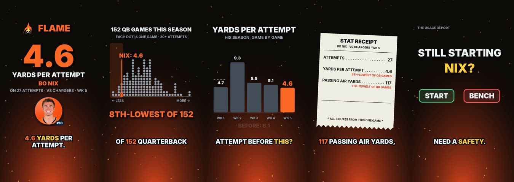
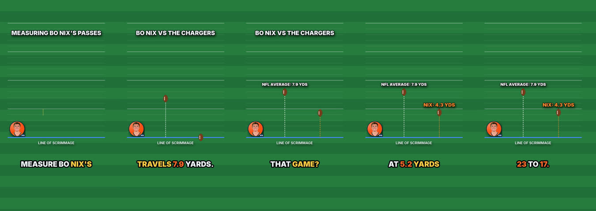
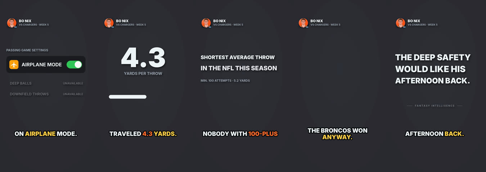
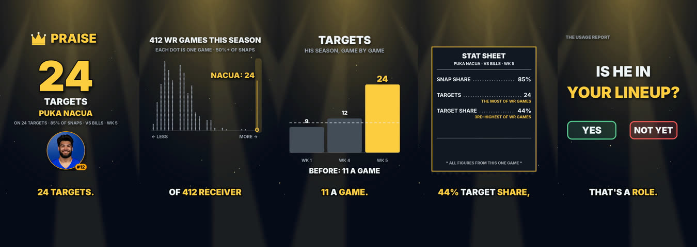
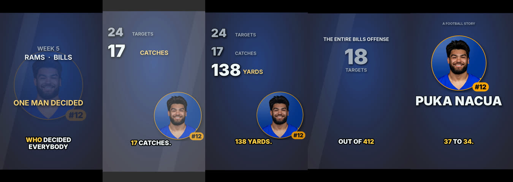
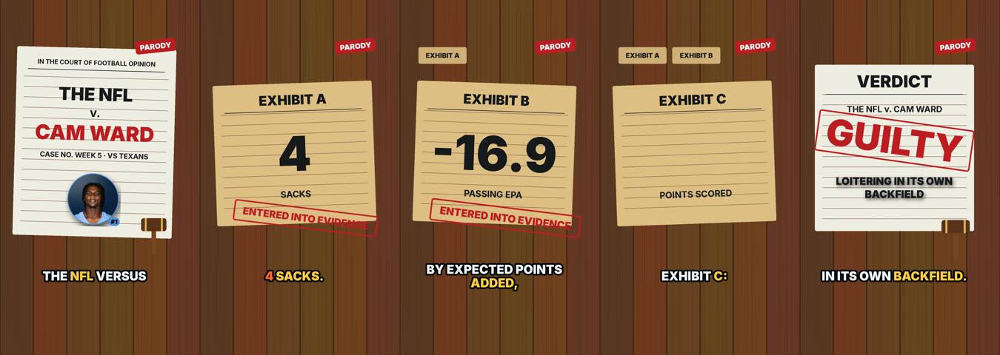

# Flame / Praise: from usage template to NFL entertainment series

Week 6 episode (Week 5 games). Everything here renders locally with the existing Pillow/FFmpeg/Kokoro pipeline; no
new models, no new dependencies. Experiments are written to `episodes/2026-w06-short-<slug>-<variant>/` beside the
approved originals, which are untouched.

## 1. Audit: why the first flame/praise videos looked the same

| Question | Finding |
|---|---|
| How subjects are selected | `stages/flame.py`: the latest game ranked against every qualifying game at the position this season (extreme 10%) and against the player's own earlier games. Sound, but the metrics were fantasy-usage metrics (target share, snap share, aDOT, EPA) and nothing measured whether a non-fantasy fan would care. |
| How scripts were generated | One `compose()` for both kinds: hook line per metric, then fixed beats. |
| Which stats were shown | Always the same four: the lead stat, its season rank, his own average, two "receipts". |
| Hard-coded sequence | `fp_hook → fp_strip → fp_own → fp_receipt → decision`, in that order, for every flame and every praise. Only colours (ember vs gold) and a word or two changed. |
| Why they look alike | Same scenes, same order, same camera, same music logic, same length (about 30 s), same ending (a start/bench or lineup question). |
| How originality was measured | `qc.gate_originality`: 5-gram text overlap, hook key, scene sequence and ending repeated three times in a row. It caught nothing here because the hook key changed per metric while everything a viewer notices stayed the same. |
| What can be reused | The whole renderer (`render_motion`: captions, transitions, camera, timing from word timestamps), `audio_design` (procedural music, sfx, mix), the claim/QC system, headshots, Kokoro and pronunciations. |
| Is the NFL data enough for non-fantasy stories? | Mostly yes, from tables we already sync: `nfl_weekly_stats` (completions, yards, TDs, INTs, sacks, air yards, YAC, EPA, receptions, rushing), `nfl_schedules` (final scores, home/away), `nfl_team_week` (team targets). Missing: play-level film context (who was open, coverage, drops), so the series never claims what happened on a play, only what the box score and play-by-play totals say. |

## 2. Creative system

Identity: **NFL entertainment, powered by real football data.** The stat supports the joke; it is not the joke.

`stages/showrunner.py` sits between selection and script:

1. **Angles**: the football premise, from verified data only, each marked `broad` when a casual fan gets it.
   - `short_throws`: a QB's average throw against the league average (and, when true, the shortest average throw in the league among QBs with 100+ attempts).
   - `rough_day`: at least two of 4+ sacks, 2+ INTs, ≤10 team points, or a top-3-worst lead stat.
   - `target_hog`: a receiver with 15+ targets, compared with the opponent's entire team targets and with how many NFL offenses drew fewer.
   - `monster_line`: a big box score (yards, TDs).
   - `stat_outlier`: the selection stat alone. It is the fallback and usually fails the entertainment test.
2. **Formats**: five shows with different structures, not skins. Each has its own scene types, opening, joke mechanism, ending, look, music and length:

| Format | Kind | Opening | Joke mechanism | Scenes | Look / music | Ending | Length |
|---|---|---|---|---|---|---|---|
| roast_monologue | flame | joke first | deadpan escalation | dp_toggle, dp_stat, dp_line, dp_end | graphite, **no music**, silence before the punchline | abrupt punchline | 12–26 s |
| courtroom (parody) | flame | case called | evidence → absurd verdict | court_docket, court_exhibit ×3, court_verdict | wood + paper, `court` mood, gavel | verdict + gavel | 22–38 s |
| comparison | both | benchmark / tease | absurd but true comparison | cmp_field (yards on a field) or cmp_tally (footballs) | turf, `drive` | callback | 15–32 s |
| main_character | praise | title card | mythmaking | cine_title, cine_slam, cine_contrast, cine_poster | letterboxed, team light, `hype`, sub booms | movie poster | 18–32 s |
| fan_meltdown | praise | fake calm | escalation | melt_calm, melt_stat ×3–4, melt_scream | pastel → red heat, `frantic`, impacts | scream + hard cut | 12–24 s |

3. **Brief** (`brief.json` + `brief.md` per episode): score = angle strength + format fit − repetition. Repetition counts the format family (2.5), look (1), opening (0.75), joke mechanism (0.75) and ending (1) of the last two series videos, so changing a sentence never counts as new. Every option considered is listed with its score. The script is rebuilt from the brief plus the resolved claims; no LLM is involved, so it is reproducible and free. `--treatment` overrides the format.
4. **Entertainment test**: *if this viewer did not play fantasy football, would it still be worth watching?* The angle must be `broad`, and the player must be recognizable (a first-round pick, a 5th-year veteran, a QB with starter volume, or top-24 at his position in volume) or the game must be the season's extreme. A brief that fails is not produced; the CLI skips it and leaves its `brief.md`.
5. **Delivery**: `‖` is a short breath and `⏸` the longer beat before a punchline (per-part pauses in `tts.py`). Speed varies by format: 0.96–1.0 for deadpan, up to 1.15 for the meltdown. A `music_drop` cuts the bed for the reveal (`series_audio.py`). New procedural sounds: gavel, record scratch, sub boom, typewriter key, crowd swell.
6. **History**: each series video records `series, format_family, story_angle, opening, joke, ending, visual_style, music_mood, music, duration_range, scenes, transitions, rhythm` in `history.jsonl`. The next brief reads it.

## 3. Technical changes

| File | Change |
|---|---|
| `studio/stages/showrunner.py` (new) | angles, formats, briefs, entertainment test, five script builders, structure/history, editorial row, thumbnail and metadata text, storyboard previews |
| `studio/series_scenes.py` (new) | five looks and 16 scene types; backdrops stay above the QC black-frame threshold |
| `studio/series_audio.py` (new) | series moods, five new sounds, music drops, the series mix |
| `studio/stages/flame.py` | new claim kinds (`fp_rate`, `fp_league_rate`, `fp_season_rate_rank/count`, `fp_points`, `fp_result`, `fp_teams_fewer_targets`, `fp_constant`); the script stage builds from the brief; `--treatment classic` keeps the first template |
| `studio/flame_scenes.py` | routes series scenes, looks, punches and sounds |
| `studio/stages/snapshot.py` | `qb_week_passing` adds TDs and INTs; new allow-listed `player_week_box` (catches, yards, TDs; no fantasy columns) |
| `studio/stages/tts.py` | optional per-part pauses |
| `studio/stages/render_motion.py` | series videos use `series_audio.mix`; render cache keys include the new modules |
| `studio/stages/qc.py` | per-format duration bounds; new `series` gate: brief exists and passed, the script matches the brief's format, parody on every courtroom frame, no fantasy-question ending, no third same-format video in a row |
| `studio/stages/metadata.py`, `thumbnail.py` | NFL tags and description, a parody disclosure, story-driven thumbnail text |
| `studio/cli.py` | `--treatment`, `--variant`, `--storyboard` |
| `tests/test_series.py` (new), `tests/test_flame.py` | 16 new tests; fixture gains box columns |

```bash
uv run make-episode --week 6 --flame-praise                               # week's flame + praise, format chosen per story
uv run make-episode --week 6 --flame-praise --player bo-nix --storyboard  # brief + script + storyboard.png, no render
uv run make-episode --week 6 --flame-praise --player bo-nix --treatment courtroom --variant court
```

## 4. Original vs new

**Bo Nix** (Week 5 at LAC: 4.3 air yards per attempt; the league average is 7.9; his 5.2 for the season is the shortest of any QB with 100+ attempts; Denver won 23–17).

- Original (classic template): "4.6 yards per attempt. Bo Nix threw it 27 times against the Chargers." → "That's the 8th-lowest of 152 quarterback games…" → own-average bars → stat receipt → "Still starting Nix?" 
- New, comparison (the engine's choice): "We tried to measure Bo Nix's passes against the Chargers. *(beat)* We needed a smaller ruler." → the average NFL pass lands at 7.9 on a drawn field, his at 4.3 → "nobody with 100-plus attempts throws it shorter" → "The Broncos won anyway, 23 to 17. *(beat)* Somebody tell the deep safety he can go home." (a sleeping safety, 19 yards off). 
- New, roast monologue (`--treatment roast_monologue`): an airplane-mode toggle switching on, one number on graphite, the season fact typed out, then "The deep safety would like his afternoon back." No music, 25 s. 

**Puka Nacua** (24 targets, 17 catches, 138 yards, 1 TD vs BUF; the entire Bills offense got 18 targets; the most of 412 WR games this season; the Rams lost 37–34).

- Original: "24 targets. Puka Nacua was plan A, plan B and plan C" → rank strip → bars → stat sheet → "Is Nacua in your lineup?" 
- New, main character: letterboxed "Week 5. The Rams and the Bills. *(beat)* And one receiver who decided everybody else was optional." → stat slams on sub booms → "The whole Bills offense got 18. Out of 412 receiver games this season, nobody's seen more." → movie poster: "The Rams lost a shootout, 37 to 34. *(beat)* Nacua did not." 

**More structures** (demo C):
- Cam Ward, courtroom (rendered): "Order in the court. The NFL versus Cam Ward…" → Exhibit A: 4 sacks → Exhibit B: by expected points added, the 3rd-worst of 152 QB games → Exhibit C: the Titans scored 3 points, at home → "guilty of loitering in its own backfield. Case closed." 
- Storyboards: [Bo Nix courtroom](storyboard-flame-bo-nix-court.jpg), [Bo Nix monologue](storyboard-flame-bo-nix-monologue.jpg), [Puka fan meltdown](storyboard-praise-puka-nacua-meltdown.jpg), [Puka comparison](storyboard-praise-puka-nacua-versus.jpg).

## 5. Outputs

| Video | Path | QC |
|---|---|---|
| Bo Nix, comparison | `studio/episodes/2026-w06-short-flame-bo-nix-series/final.mp4` | 13/13 gates |
| Puka Nacua, main character | `studio/episodes/2026-w06-short-praise-puka-nacua-series/final.mp4` | 13/13 |
| Cam Ward, courtroom | `studio/episodes/2026-w06-short-flame-cam-ward-series/final.mp4` | 13/13 |
| Bo Nix, roast monologue | `studio/episodes/2026-w06-short-flame-bo-nix-monologue/final.mp4` | 13/13 |
| Originals (unchanged) | `…-flame-bo-nix/`, `…-praise-puka-nacua/` | as approved |

Each folder also has `brief.md`, `review.md` (every number with its source) and `thumbnail.png`. Experiments carry `variant_of` and are kept out of the channel history.

## 6. Quality report

- **Automated**: 95 tests pass. The 16 new ones cover format selection, history steering, forced treatments, the entertainment test, benchmark eligibility, the "about half" guard, scene types and endings not shared across formats, claim re-derivation for every series claim, a frame drawn for every scene, the series QC gate (fantasy ending, parody label, three in a row, missing brief), history fields, NFL metadata and the classic template. All four demos pass every QC gate, including the unchanged number-provenance and banned-phrase gates.
- **Factual checks made while writing** (fixed before render): "Denver won anyway" was hard-coded rather than a claim (now `{result}`); a "no points / turnovers" premise was false for Cam Ward (3 points, 1 INT; removed); "shootout" is only said when both teams scored 27+; "about half" only when the share is 45–55%; "nobody's seen more" names its denominator (412 WR games).
- **Editorial review**, honest:

| | Bo comparison | Puka main character | Cam Ward courtroom | Bo monologue |
|---|---|---|---|---|
| Would a non-fantasy NFL fan enjoy it? | yes: one clear, visual idea | yes: the Bills comparison lands | mostly; EPA is still a nerd stat | yes, if deadpan is your humor |
| Opening interesting immediately? | yes (the ruler joke) | slower: a title card for about 8 s | "Order in the court" is clear | yes (airplane mode) |
| A real joke or payoff? | sleeping-safety callback | "Nacua did not." | the verdict is mild | strongest punchline of the set |
| Natural delivery? | good | the title card reads a bit slow | good | Kokoro's flat read suits deadpan |
| Visually different? | yes | yes | yes | yes |
| Repetitive vs recent videos? | no | no | no | no |
| Reason to share? | "shortest throws in the NFL" is arguable | "out-targeted a whole offense" | the parody format | the airplane-mode line |
| Claims defensible? | yes | yes | yes | yes |

## 7. Limitations (what still feels artificial)

- One narrator voice for every format; Kokoro can't really yell, so the meltdown is loud in the visuals but not in the voice.
- The joke banks are small (one or two lines per format and angle). With a few weeks of data the same punchline will come back for the same angle; history steers the format, not the line.
- Only five formats are built. The fake apology, autopsy, hater's victory lap, apology tour and origin story are not.
- Main character opens slowly; the deadpan screens leave a lot of empty space by design, which may read as unfinished on a phone.
- Angles cover QB passing and receiver volume well. RB rushing stories, multi-game streaks, turnovers as a premise, and team-level collapses are not angles yet.
- No film context: the series can't say why something happened, only that it did.
- Headshots stay behind the config switch, as before (not licensed to the channel).

## 8. Next improvements (in order)

1. Grow the joke banks (3–5 lines per format × angle) and rotate them by history, like the formats. Optionally let the local Qwen draft alternatives into the bank offline, with a human picking what stays (never at render time).
2. Add RB and turnover angles (rushing yards/EPA, multi-INT games, fumbles lost) and one multi-game streak angle.
3. Tighten main character's title card to about 4 s and give praise a second cold open.
4. Build the fake apology (parody-labelled) and the autopsy as the next two formats; they reuse the court/paper and deadpan kits.
5. Once anything is published, record retention per format in `metadata.experiment` and let real numbers, not these heuristics, reweight `FIT`.
