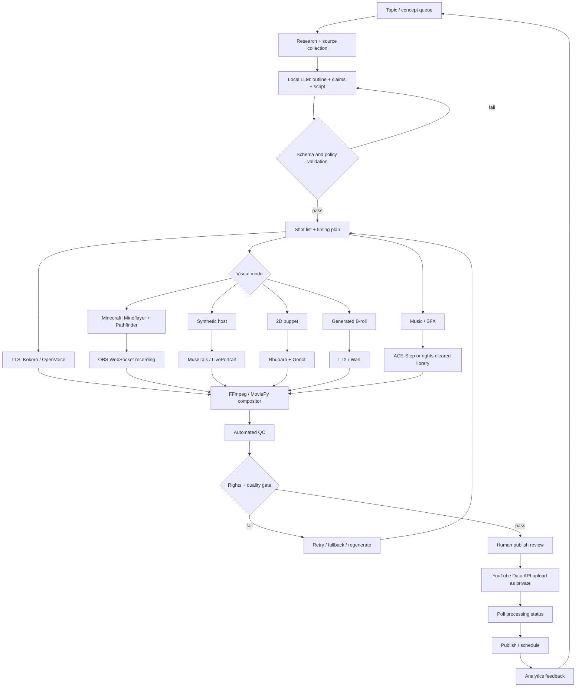

# Feasibility of a Fully AI-Powered YouTube Channel Using Public GitHub Repositories

## Executive summary

A YouTube channel whose **research, scripting, narration, visuals, gameplay capture, animation, music, editing, metadata, uploading, and performance-feedback loop are almost entirely automated with public GitHub software is technically feasible today**. The harder question is whether a **zero-human, high-volume channel remains monetizable, legally clean, and sufficiently original**. That is materially less certain.

My overall assessment is:

| Dimension | Feasibility | Assessment |
|---|---:|---|
| Fully automated technical production | **9/10** | Mature open-source components exist for essentially every stage. |
| High-quality voice-only/narrated channel | **9/10** | Strongest risk-adjusted format. Local TTS, LLMs and FFmpeg-class tooling are mature. |
| AI-generated recurring human host | **7/10** | Technically straightforward; likeness, disclosure, lip-sync quality and uncanny-valley issues increase risk. |
| Automated Minecraft gameplay + narration | **8/10** | Mineflayer makes genuine programmatic gameplay feasible; Minecraft explicitly permits monetized videos with unique content/commentary. citeturn19search7turn21search1 |
| Generic Subway Surfers loops | **2/10** | Poor choice: publisher terms create commercial/automation problems, on top of YouTube's template/inauthentic-content risk. |
| Fully automated kids channel | **4/10** | Technically easy but commercially and legally the highest-risk category because of COPPA, reduced advertising functionality and YouTube's kids-quality enforcement. citeturn21search0turn21search17turn21search7 |
| Zero-human publishing with YPP resilience | **5/10** | Feasible mechanically, but a final editorial/compliance gate is strongly advisable. |
| AI-driven production with a short human publish gate | **8–9/10** | Best overall configuration. |

The most important finding is that **YouTube does not categorically prohibit or demonetize AI-generated content**. Its current monetization rules instead target **mass-produced, highly repetitive, generic or templated content**, explicitly including AI-generated material that gives the impression of mass production without original perspective. YouTube renamed its former “repetitious content” policy to **“inauthentic content” on July 15, 2025** and continues to allow transformed/original content with meaningful commentary, narrative or educational value. citeturn21search23

That distinction dictates the viable business model. An automated system that publishes “LLM script + stock visual loop + synthetic voice” hundreds of times is technically trivial but strategically weak. A system that uses AI to produce **genuinely different stories, investigations, tutorials, Minecraft challenges, explainers or character-driven episodes** is much more defensible under the same tooling. citeturn21search23

The strongest open-source stack for a commercial US/English channel is approximately:

**Qwen-family open weights → llama.cpp/vLLM → Kokoro or OpenVoice → Mineflayer/OBS, LTX/Wan/MuseTalk, or Rhubarb/Godot → ACE-Step or rights-cleared audio → FFmpeg/MoviePy → automated QC → YouTube Data API.**

Qwen3's open-weight models are Apache-2.0; llama.cpp supplies a lightweight OpenAI-compatible local inference server; vLLM is attractive at higher throughput. citeturn19search2turn19search0turn19search4turn19search1 Kokoro has Apache-licensed weights and an 82-million-parameter footprint, while OpenVoice V2 is MIT-licensed and explicitly permits commercial use, including voice cloning. citeturn17search0turn17search1

Several famous “open-source AI” options are **poor commercial choices despite their code being open**. F5-TTS has MIT code but official pretrained weights under CC-BY-NC; XTTS-v2's weights remain subject to the non-commercial Coqui Public Model License; Wav2Lip's official repository is limited to personal/research/non-commercial use; and Meta AudioCraft has MIT code but non-commercial model weights. citeturn17search2turn17search15turn18search3turn20search23

The licensing lesson is critical: **audit code, model weights, bundled models, reference data, voice rights and final-content rights separately.** An MIT `LICENSE` at the repository root does not automatically mean every downloaded checkpoint is safe for a monetized YouTube channel.

For the proposed content concepts, the risk-adjusted ranking is:

1. **Original narrated voice channel:** best.
2. **Minecraft AI-agent challenge/parkour channel:** very good if gameplay is your own and narration is substantively connected to it.
3. **Synthetic recurring host:** viable with an invented identity and proper AI disclosure.
4. **Procedural/cartoon puppet channel:** excellent alternative to photorealistic hosts.
5. **Pure generative-video entertainment:** feasible but expensive and vulnerable to visual sameness.
6. **Kids content:** possible, but only with substantial editorial quality control.
7. **Automated Subway Surfers background loops:** not recommended.

The recommended goal therefore is not “remove humans at any cost.” It is **automate approximately 95–99% of production while preserving a short human rights/quality/publish gate**. The system can remain AI-powered while materially lowering the risk of copyright claims, accidental impersonation, hallucinated claims, inappropriate kids content, broken rendering and YPP rejection.

## Open-source project inventory and commercial licensing

The table below prioritizes upstream repositories and official project documentation. “Maturity” is an engineering assessment based on project activity, ecosystem, documented interfaces and demonstrated production use rather than merely GitHub stars. “Integration” estimates the work needed for a competent Python/JavaScript developer.

| Category | Project | License / monetization status | Maturity | Integration | Commercial YouTube assessment |
|---|---|---|---|---|---|
| TTS | **Kokoro** | Apache-licensed weights; project describes production deployment as permitted. citeturn17search0 | High | Easy | **Strong choice** for non-cloned narration. |
| Voice cloning | **OpenVoice V2** | MIT; upstream explicitly says V1/V2 are free for commercial use. citeturn17search1turn17search25 | High | Medium | **Strong choice**, provided the reference voice is yours or licensed/consented. |
| TTS / cloning | **F5-TTS** | Code MIT; official pretrained models CC-BY-NC because of training data. citeturn17search2 | High | Medium | **Do not use official weights for monetized production.** |
| TTS / cloning | **XTTS-v2 / Coqui TTS** | Toolkit and model licensing differ; XTTS weights remain CPML/non-commercial. citeturn17search15turn17search35 | Medium | Easy–Medium | **Avoid for monetized output** absent a valid commercial grant. |
| Script generation | **Qwen3** | Open-weight models Apache-2.0. citeturn19search2 | High | Easy | **Strong choice.** |
| LLM runtime | **llama.cpp** | Permissive local inference project with OpenAI-compatible server and quantization support. citeturn19search0turn19search4 | Very high | Easy | **Best low/medium-volume local runtime.** |
| LLM runtime | **vLLM** | High-throughput inference/serving with OpenAI-compatible API and wide accelerator support. citeturn19search1turn19search5 | Very high | Medium | **Best when concurrency/throughput matters.** |
| AI video | **LTX-Video / LTX family** | Repository Apache-2.0; current desktop project warns that separately downloaded model weights can carry additional terms, so exact checkpoint must still be audited. citeturn22search1turn22search5 | High / rapidly evolving | Medium–Hard | **Promising**, particularly for short B-roll and scene generation. |
| AI video | **Wan2.2** | Public video-generation stack supporting T2V/I2V/TI2V and 480p/720p modes. citeturn22search0 | High | Hard | **Good generator candidate**, but GPU cost makes it less attractive for entire 10-minute videos. |
| Talking host | **MuseTalk** | Upstream code/model documentation supports commercial usage; project reports real-time-capable lip sync on high-end hardware. citeturn18search0turn4view1turn5view3 | High | Medium–Hard | **Best current OSS lip-sync candidate** among the projects reviewed. |
| Portrait animation | **LivePortrait** | Core project is MIT, but the default InsightFace model dependency has non-commercial model restrictions; upstream/community guidance recommends replacing it for commercial pipelines. citeturn7view0turn18search13 | High | Medium | **Usable only after dependency audit/replacement.** |
| Talking head | **SadTalker** | Upstream states license changed to Apache-2.0 and its prior non-commercial restriction was removed. citeturn18search2 | Medium | Medium | **Potentially usable**, but audit all auxiliary checkpoints/dependencies before production. |
| Lip sync | **Wav2Lip** | Official repository says personal/research/non-commercial only. citeturn18search3 | High research maturity | Medium | **Red light for a monetized channel.** |
| Minecraft agent | **Mineflayer** | MIT; high-level JS API, also usable from Python, with movement, inventory, building, combat and world interaction. citeturn19search7 | Very high | Easy–Medium | **Excellent** for real autonomous Minecraft footage. |
| Minecraft navigation | **mineflayer-pathfinder** | MIT; autonomous static/dynamic/composite navigation goals. citeturn19search23 | High | Easy | **Excellent companion to Mineflayer.** |
| Gameplay capture | **OBS Studio + obs-websocket** | OBS ecosystem is GPL; WebSocket remote control is included in modern OBS. citeturn20search0turn20search8 | Very high | Easy | **Excellent** for automated recording. |
| 2D puppet | **Rhubarb Lip Sync** | MIT; upstream specifically describes commercial use as permitted. citeturn20search9 | Mature/stable | Easy | **Very strong low-compute alternative to photorealistic hosts.** |
| 2D/3D procedural animation | **Godot** | MIT, with commercial use and no royalties according to the Godot project. citeturn16search3turn16search11 | Very high | Medium | **Excellent** for original animated characters/backgrounds. |
| Video assembly | **FFmpeg** | Mostly LGPL-2.1+; optional components can make a particular build GPL. citeturn16search0turn16search12 | Extremely high | Medium | **Core production dependency.** Audit the exact binary/build if redistributing software. |
| Python editing | **MoviePy** | MIT. citeturn16search1turn16search5 | Medium–High | Very easy | Good orchestration layer; use FFmpeg directly for performance-critical renders. |
| Music | **ACE-Step** | Original public project is an open music-generation foundation model; the reviewed release uses a permissive license and provides local inference/API paths. citeturn20search6turn14view0 | Emerging–High | Medium | **Promising commercial candidate**, but archive the precise checkpoint/license used. |
| Music/SFX | **AudioCraft / MusicGen / AudioGen** | Code MIT, model weights CC-BY-NC 4.0. citeturn20search3turn20search23 | High | Medium | **Official weights are unsuitable for monetized production.** |

A useful architecture rule is to treat licensing as a **five-layer dependency graph**, not as a repository checkbox:

| Layer | Question | Failure example |
|---|---|---|
| Software source | May the program itself be used commercially? | Wav2Lip's repository explicitly restricts commercial use. citeturn18search3 |
| Model weights | Are pretrained checkpoints commercially usable? | F5-TTS code is MIT while pretrained weights are CC-BY-NC. citeturn17search2 |
| Bundled models/dependencies | Are face detectors, vocoders, upscalers, etc. separately restricted? | LivePortrait's InsightFace model path introduces a non-commercial restriction unless replaced. citeturn7view0turn18search13 |
| Source/reference material | Do you have rights to the speaker, portrait, gameplay asset or training/reference input? | An MIT voice-cloning engine does not create consent to clone another person's voice. YouTube separately protects identifiable synthetic likenesses. citeturn1search11 |
| Final-media rights | Does a third-party game/music/video owner allow monetized use? | YouTube says gaming content needs the commercial-use rights granted by the game's publisher. citeturn10search11 |

This is why “open source” and “monetizable” are not synonyms.

For a commercial build, I would create a machine-readable `provenance.json` for every episode containing the Git commit, model/checkpoint hash, license snapshot, source asset identifiers, voice-consent record, game/publisher terms version, generation prompt and final artifact hashes. That turns an otherwise informal AI workflow into an auditable rights chain.

## Quality, integration difficulty, and hardware

There is no meaningful single benchmark that compares TTS naturalness, lip-sync accuracy, AI-video realism and game capture. The projects report heterogeneous metrics, often under different GPUs and resolutions. The following table therefore uses **project-reported operational measurements**, not a claim that the projects were independently tested against each other.

| Tool | Project-reported or measurable quality | Hardware/runtime implications | Practical assessment |
|---|---|---|---|
| **Kokoro** | 82M parameters; Apache-licensed open weights; standard pipeline supports selectable voices and speed. The implementation uses 24 kHz audio. citeturn17search0turn4view3 | Small enough to run locally at far lower cost than large diffusion TTS systems. | Very good narration/cost tradeoff. |
| **OpenVoice V2** | Upstream emphasizes tone-color cloning plus control of emotion, accent, rhythm, pauses and intonation; V2 added better audio quality and native multilingual support. citeturn17search1turn17search17 | More moving parts than Kokoro but practical on a single local system. | Prefer when identity/style control matters. |
| **MuseTalk** | Project reports **30 fps+ on a Tesla V100**; its generated face region is only 256×256, so final apparent quality also depends heavily on source footage, compositing and restoration. citeturn18search0turn18search8 | A 4 GB GPU can run the published pipeline but very slowly; high-throughput/realtime operation benefits substantially from stronger GPUs. citeturn5view3turn18search20 | Good lip sync, but the 256px face crop is the main visual-quality limitation. |
| **SadTalker** | Supports single-image talking heads and has a 512×512-oriented model path. citeturn18search2turn3search2 | Older pipeline and dependency stack than MuseTalk. | Suitable for stylized or medium-size presenter shots; less compelling for photoreal close-ups. |
| **LivePortrait** | Designed for efficient motion/expression transfer rather than purely audio-driven lip sync. Apple Silicon is supported, though upstream reports a large performance gap versus RTX 4090-class acceleration. citeturn4view0 | CUDA is preferable; commercial deployments should replace restricted InsightFace model components. citeturn7view0 | Excellent for reusable synthetic-character animation. |
| **LTX-Video** | Current project claims high-resolution synchronized A/V generation and up to 4K/50fps capability in its modern stack. citeturn22search1 | Much more GPU-intensive than TTS or lip-sync. Separate weight/license audit remains necessary. citeturn22search5 | Use selectively for hero shots/B-roll rather than every frame. |
| **Wan2.2** | Official repository exposes 480p/720p text-, image- and speech-conditioned video variants; the TI2V 5B configuration supports 1280×704 generation. citeturn22search0 | Video diffusion dominates compute and render time. | Good for short generated sequences; inefficient as a substitute for all gameplay/B-roll. |
| **ACE-Step** | Project-reported performance includes very fast music generation on high-end accelerators and reduced-memory modes around consumer-GPU territory. citeturn14view0 | GPU useful but audio generation is dramatically cheaper than video diffusion. | Reasonable for unique beds/stingers after rights audit. |
| **Mineflayer + OBS** | No generative-video artifacts: output quality is simply the rendered game/client/capture resolution. Mineflayer controls genuine Minecraft gameplay while OBS records it. citeturn19search7turn20search8 | Much cheaper per finished minute than generative video. | Best source of scalable “moving visual” footage in this proposal. |

For local LLM scripting, quantization changes the economics considerably. As a rough engineering floor, an 8-billion-parameter model quantized to 4 bits contains about **4 GB of raw weight data** before runtime/KV-cache overhead; a 14-billion-parameter model is about **7 GB**. Therefore, systems with roughly 8–16 GB of usable RAM/VRAM can run useful smaller script models, while larger contexts and higher throughput favor more memory. llama.cpp explicitly supports quantized inference on CPU and GPU and exposes schema-constrained JSON responses, which is particularly useful for machine-generated shot lists rather than free-form prose. citeturn19search4

For production, I would separate machines by workload rather than force everything onto one GPU:

| Workload tier | Recommended environment |
|---|---|
| LLM + TTS + FFmpeg | Modern CPU, 16–32 GB RAM is enough for a low-volume pipeline; GPU optional. |
| Minecraft bot/capture | CPU plus whatever GPU is needed to render the desired Minecraft settings; no generative-video GPU required. |
| 2D puppet | CPU-first; Rhubarb/Godot can be inexpensive. |
| MuseTalk/LivePortrait | Practical production target: modern NVIDIA GPU with generous VRAM; stronger GPU primarily buys throughput. |
| Wan/LTX-class diffusion video | Treat as a dedicated GPU workload; short-shot generation is economically preferable to synthesizing the full episode. |
| High-volume LLM serving | vLLM on dedicated accelerators becomes worthwhile once parallel jobs justify it. vLLM currently supports NVIDIA, AMD, Intel and multiple other accelerator back ends. citeturn19search1 |

This yields an important cost-quality result: **the cheapest way to make a visually dynamic AI channel is usually not AI-generating every frame.** Genuine Minecraft capture, procedural Godot animation, reusable virtual-host footage and conventional motion graphics can run orders of magnitude more finished minutes per GPU-hour than diffusion video. Generative video should be treated as a scarce “B-roll/hero shot” resource unless the visual generation itself is the channel's differentiator.

## End-to-end automation architecture

A robust system should model an episode as an immutable job with structured intermediate artifacts rather than as one giant script. YouTube's own API supports programmatic uploads, status checks and metadata updates; its documentation specifically exposes `videos.insert` for uploading and `videos.list` processing details for determining whether processing succeeded or failed. citeturn15search2turn15search17



The LLM should not output only a script. It should output a validated object, for example:

```json
{
  "episode_id": "mc_parkour_0042",
  "title_candidates": [],
  "claims": [],
  "narration_segments": [],
  "shots": [],
  "music_cues": [],
  "synthetic_content_disclosure": true,
  "made_for_kids": false,
  "rights_manifest": [],
  "expected_duration_seconds": 620
}
```

llama.cpp's server supports schema-constrained JSON generation, which is useful for making this deterministic enough for downstream automation. citeturn19search4

Error handling should be designed around **idempotency and checkpoints**. Each stage should consume versioned files and produce versioned files. If the avatar render fails at minute eight, the system should not regenerate the research, script and narration. A content hash of the input bundle can identify whether an existing successful artifact can be reused.

Recommended automated gates include:

| Stage | Automated tests | Failure action |
|---|---|---|
| Research/script | Missing citations, unsupported factual claims, duplicate topic, unsafe entities, malformed JSON | Re-prompt LLM or move to manual review |
| TTS | Duration bounds, excessive silence, clipping, empty audio, pronunciation dictionary violations | Retry alternate voice/settings |
| Gameplay | Bot stuck, death loop, static screen, disconnect, repeated path | Reset world/checkpoint or regenerate run |
| Host video | Missing face, obvious face drift, frame freeze, incorrect duration | Fallback from host to puppet/B-roll |
| Generated video | Failed decode, wrong resolution, severe temporal instability | New seed/model or replace with procedural shot |
| Assembly | Missing streams, A/V duration mismatch, subtitle overflow, black frames | Re-render affected segment |
| Originality | Excessive perceptual similarity to prior episodes, repeated script phrases, identical story structure | Send back to concept stage |
| Rights | Unapproved model checkpoint, unlicensed music/game asset, non-consented voice | Hard fail; no automatic override |
| Upload | API/network failure | Resumable/retried upload; YouTube supports resumable upload flows. citeturn15search29 |
| Processing | YouTube reports failed processing | Re-encode and re-upload; status can be polled via the API. citeturn15search17 |

The **originality gate is commercially important**, not just stylistic. YouTube explicitly identifies repetitive videos with minimal variation, repeated scenarios/storylines, templated slideshows and generic mass-produced AI content as examples that may not monetize. citeturn21search23 A production system therefore needs a diversity metric just as much as it needs an audio-quality test.

An effective implementation would store:

`episode.sqlite/postgres record → source manifest → structured script → WAV stems → raw footage → shot clips → edit decision list → final master → thumbnail → upload metadata → YouTube video ID → analytics snapshots`.

For low volume, plain Python plus SQLite/PostgreSQL and a work queue is sufficient. There is no need to introduce Kubernetes or a sophisticated workflow engine immediately. At high volume, durable job orchestration becomes worthwhile because GPU render jobs can run for long periods and fail asymmetrically.

## Content-format viability, YouTube policy, COPPA and rights risk

The fundamental YouTube-policy variable is not “AI versus human.” It is **original value versus interchangeable mass production**.

YouTube's current monetization page explicitly states that channels whose videos feel interchangeable or look as though they were produced from a template without meaningful creative/educational value may not monetize. The policy gives as disallowed examples repetitive low-value videos and AI-generated content made from generic or unoriginal templates. Conversely, transformed content with meaningful commentary, storyline or editing can monetize even when source material is reused, subject separately to copyright. citeturn21search23

| Concept | Technical viability | YPP viability | Rights/policy risk | Recommendation |
|---|---:|---:|---:|---|
| **Original voice/narration channel** | Very high | High | Low–Medium | **Best starting point** |
| **Synthetic invented host** | High | Medium–High | Medium | **Good**, disclose realistic synthesis where required |
| **Minecraft AI challenges / parkour** | Very high | High if genuinely original | Low–Medium | **Excellent** |
| **Procedural cartoon/puppet series** | Very high | High | Low | **Excellent**, especially for avoiding deepfake concerns |
| **Generative-video fiction/visual essays** | High | Medium–High | Medium | Good, but compute-intensive |
| **Subway Surfers background loop + unrelated narration** | High technically | Low | High | **Avoid** |
| **Mass-produced generic fact/story Shorts** | Very high | Low | High | **Avoid as a core strategy** |
| **Automated kids entertainment** | Very high | Low–Medium | Very high | Only with serious editorial/compliance controls |

**Voice channel.** This is the most attractive format because narration quality is now strong while graphics can be composed from original diagrams, procedural animation, generated B-roll, licensed imagery and gameplay. To stay monetization-safe, the differentiation must live in the research, argument, storytelling and editing—not just a new title attached to the same visual template. citeturn21search23

**Generated host.** A wholly fictional recurring host avoids many—but not all—likeness problems. YouTube requires disclosure for realistic altered/synthetic material in circumstances such as making a real person appear to say/do something they did not or creating realistic synthetic depictions viewers could mistake for reality; ordinary AI assistance such as script generation does not itself require disclosure. citeturn1search1 YouTube also allows individuals to request removal of realistic synthetic content that uses their identifiable face or voice, and impersonation remains prohibited irrespective of AI labeling. citeturn1search11turn1search17

The safest host strategy is therefore an **invented person or visibly stylized character whose face and voice are not modeled on a public figure or non-consenting individual**.

**Minecraft obstacle-course/parkour loops.** This is much stronger than downloading generic gameplay. Mineflayer gives the production system control of an actual Minecraft agent, making each run genuinely generated from the channel's own gameplay. citeturn19search7turn19search23 Mojang's current usage guidelines explicitly say creators may make money from videos containing their own unique content and commentary through advertising. citeturn21search1 YouTube separately notes that monetized gaming videos require the commercial rights granted by the game's publisher and that simple extended gameplay can be problematic when publisher permissions or added value are insufficient. citeturn10search11

The best version is consequently not “random Minecraft footage under an unrelated Reddit story.” It is something like:

> “I gave an AI Minecraft agent five attempts to cross a dynamically generated obstacle course, and after every failure another model rewrote its strategy.”

The gameplay, narration and concept then form a single original work.

**Subway Surfers loops.** This concept has much poorer risk-adjusted economics. The reviewed SYBO terms characterize the service license as personal/non-commercial and include restrictions around automation/bots/scripts interacting with the service. citeturn12view0 That means there are two independent problems: publisher authorization for monetized footage/automation, and YouTube's reluctance to monetize low-variation template content. Permission from the publisher would address only the first issue, not the second. YouTube explicitly states that reused-content decisions are distinct from copyright/permission. citeturn21search23

**Kids channel.** This is the category where “fully automatic” is least advisable. YouTube determines whether content is made for children based on factors including subject matter, child-oriented characters/toys/games, child-friendly language, songs/stories and the intended/actual audience; mixed-audience child-directed material can still fall within made-for-kids treatment. citeturn2search2

Made-for-kids videos lose or restrict important engagement/data features; YouTube notes that features such as comments and notifications are disabled in this context. citeturn21search21 Personalized advertising is not allowed on made-for-kids content, although eligible contextual advertising can still appear. citeturn21search7turn21search10 YouTube additionally applies dedicated kids/family quality principles: channels with a strong focus on low-quality made-for-kids material can be suspended from the YouTube Partner Program. citeturn21search17turn21search0

COPPA creates an external legal layer. The FTC has long treated operators of child-directed online content—including relevant channel operators—as having responsibilities regarding children's information, and the Commission updated its COPPA framework again in 2025; policy work continued into 2026. citeturn2search1turn2search0turn2search8turn2search12

Accordingly, I would **not make kids content the first automated channel**. A children's channel benefits least from aggressive low-cost automation while incurring the most platform and regulatory scrutiny.

Rights and attribution create additional risk beyond YPP:

**Voice cloning:** an MIT license for OpenVoice grants software rights, not permission to appropriate somebody else's voice. Use your own voice, commissioned talent with an explicit synthetic-voice clause, or a wholly generated voice. YouTube's synthetic-likeness/privacy mechanisms add platform risk even before considering state publicity/privacy law. citeturn17search1turn1search11

**AI music:** model licensing is only one part of the risk. ACE-Step itself acknowledges possible issues such as unintentional copyright similarity and stylistic resemblance. citeturn20search2 A production music checker should therefore compare generated tracks against previous channel tracks, preserve prompts/seeds/checkpoint provenance and reject suspiciously recognizable melodies.

**Copyrightability:** the US Copyright Office's 2025 report concluded that generative-AI outputs can receive copyright protection where a human author has contributed sufficient protectable expressive authorship; merely supplying prompts does not, by itself, necessarily establish that level of authorship. citeturn15search6 A completely autonomous output can therefore create a paradox: it may be cheap to produce but offer weaker copyright protection than a meaningfully human-edited work.

**Deepfake/reputation risk:** don't optimize for “beating AI detection.” Assume realistic synthetic footage can be labeled, complained about, manually reviewed or tied back to generation tools. The commercially robust posture is accurate disclosure and provenance, not hoping synthetic material remains undetected. YouTube's altered-content disclosure and synthetic-likeness complaint systems make this the safer assumption. citeturn1search1turn1search11

## Monetization paths, revenue sensitivity, and operating costs

As of October 2026, YouTube's full advertising-revenue eligibility route requires **1,000 subscribers plus either 4,000 qualified public watch hours during the prior 12 months or 10 million qualified Shorts views during the prior 90 days**. citeturn15search0 The expanded YPP provides earlier access to certain monetization features at **500 subscribers, three valid public uploads in 90 days and either 3,000 qualified watch hours or 3 million qualified Shorts views**, where available. citeturn15search16 YouTube has already announced additional YPP activity-rule changes scheduled for February 1, 2027, so a 2027 business plan should re-check the then-current rules. citeturn15search7

For YPP members accepting the relevant modules, YouTube currently says creators receive **55% of net Watch Page ad revenue**, **45% of their allocated Shorts Creator Pool revenue**, and **70% of net revenue from supported fan-funding products such as channel memberships, Super Chat, Super Stickers and Super Thanks**. citeturn15search1

Potential monetization therefore includes:

| Source | Best fit | Main constraint |
|---|---|---|
| Watch-page advertising | Long-form explainers, stories, Minecraft challenges | Requires YPP and policy-safe original content |
| Shorts revenue | Discovery funnel | Very large view counts needed; economics differ from long form |
| Sponsorships | Adult/general audience channels | Sponsor brand-safety and synthetic-host disclosure expectations |
| Affiliate links | Tutorials/product-adjacent content | Requires genuine useful content and appropriate disclosures |
| Memberships / Supers | Personality or community-driven channel | Harder for a faceless commodity channel; YouTube pays 70% of net fan-funding revenues under the relevant module. citeturn15search1 |
| Digital products | Educational/technical channels | Works only if channel builds trust and expertise |
| Licensing original assets/music/characters | Strong original-IP channel | AI copyrightability and model provenance become especially important |
| Cross-platform syndication | Original short/long content | Platform-specific rules must be checked independently |

Revenue forecasting from YouTube alone is inherently speculative because YouTube does not publish a universal creator RPM. A more honest estimate is a **sensitivity model**.

The following RPM figures are **planning assumptions, not claimed industry averages or guarantees**:

| Monthly monetized views | At $1 long-form RPM | At $3 RPM | At $6 RPM |
|---:|---:|---:|---:|
| 100,000 | $100 | $300 | $600 |
| 500,000 | $500 | $1,500 | $3,000 |
| 1,000,000 | $1,000 | $3,000 | $6,000 |
| 5,000,000 | $5,000 | $15,000 | $30,000 |
| 10,000,000 | $10,000 | $30,000 | $60,000 |

Thus the model should be read as:

\[
\text{monthly ad revenue} =
\frac{\text{monetized views}}{1000}
\times
\text{realized RPM}
\]

rather than “an AI channel will earn $X.”

For made-for-kids material, I would model conservatively because personalized ads are prohibited and advertising categories are more restricted, even though contextual ads can still run. citeturn21search7turn21search16 The exact RPM effect is channel-specific, so it should not be replaced by a generic percentage discount.

The operating-cost advantage of an open-source stack is substantial because software license fees can approach zero. The costs shift to GPU time, electricity, storage, bandwidth, monitoring and human quality assurance.

The scenarios below deliberately use **assumed GPU-hour prices rather than claiming a current provider price**.

| Scenario | Production design | Illustrative monthly resource model | Estimated monthly cash cost* |
|---|---|---|---:|
| **Low** | 8–12 long videos; local Qwen/Kokoro; Minecraft/procedural visuals; very little diffusion | Existing computer; 0–20 rented GPU-h at assumed $0.75/h; 100–500 GB backup; small VPS | **$20–$100** |
| **Medium** | 20–30 videos; recurring avatar, more AI B-roll/music; local + rented GPU | 50–200 GPU-h at assumed $1.50/h; 1–3 TB working/archive storage; monitoring/orchestration | **$150–$600** |
| **High** | Daily long-form plus multiple Shorts; heavy LTX/Wan/avatar generation; parallel jobs | 500–1,500 GPU-h at assumed $2/h plus several TB storage/egress and production infrastructure | **$1,200–$4,000+** |

\*Excludes labor, taxes, hardware purchase/amortization and paid third-party assets. These are engineering budget scenarios, not quoted cloud-provider prices.

The low scenario is unusually viable because the expensive components are optional. An episode can be:

- Qwen script: pennies-worth of local electricity;
- Kokoro narration: local inference;
- Mineflayer gameplay: ordinary game rendering;
- OBS capture;
- FFmpeg subtitles/compositing;
- existing/rights-cleared music.

The expensive leap occurs when every scene becomes diffusion-generated video. That produces higher novelty per shot but also increases retries, storage, GPU occupancy and consistency failures.

A useful break-even calculation is:

\[
\text{break-even monthly views}
=
\frac{\text{monthly production cost}}{\text{RPM}}
\times 1000
\]

At a hypothetical **$3 RPM**, a $300/month workflow needs about **100,000 monetized monthly views** to cover its production infrastructure; a $3,000/month high-end workflow needs about **1 million**. This excludes labor and tax.

These economics strongly favor **Minecraft/procedural/host-reuse architectures over full generative video during channel validation**.

## Recommended architecture and next steps

The best initial system is a **commercially conservative modular stack**, not the flashiest possible collection of models.

| Pipeline role | Recommended first choice | Alternative | Avoid initially |
|---|---|---|---|
| Research/script | **Qwen3 + llama.cpp** | Qwen + vLLM at scale | Huge models merely for longer scripts |
| Default narration | **Kokoro** | OpenVoice with owned/consented voice | XTTS official weights, F5 official weights |
| Recurring synthetic voice | **OpenVoice V2** using owned/commissioned reference | Fully synthetic Kokoro identity | Celebrity/public-figure clones |
| Gameplay | **Mineflayer + Pathfinder + OBS** | Manual/pre-scripted Minecraft client | Automated Subway Surfers |
| Synthetic human | **MuseTalk with an invented/licensed character** | LivePortrait with commercial-safe face detector | Wav2Lip official repo |
| Non-human host | **Rhubarb + Godot** | LivePortrait stylized character | Photoreal host when unnecessary |
| Generated B-roll | **Short LTX/Wan clips** | Procedural/stock/right-cleared visuals | Diffusion-generating an entire 10-minute episode |
| Music | **ACE-Step after checkpoint-level audit** | YouTube/CC0/original commissioned audio | AudioCraft official weights |
| Assembly | **FFmpeg** | MoviePy wrapping FFmpeg | GUI-only editing that blocks automation |
| Upload | **YouTube Data API** | Manual Studio publish | Direct public upload before QC |

The first channel I would build is either an **AI-narrated original explainer/story channel** or an **AI Minecraft-agent challenge channel**.

For Minecraft, a particularly automation-friendly format would be:

> **“AI vs procedurally generated Minecraft challenge”**

The orchestration process generates a course or challenge seed, creates an objective, asks the LLM to choose an initial strategy, runs Mineflayer, records outcomes, feeds event logs back to the model, retries under revised strategies, and writes the narration around what *actually happened*. Mineflayer already provides the game-level APIs and pathfinding ecosystem needed for autonomous interaction. citeturn19search7turn19search23

That design has several advantages simultaneously: footage is genuinely yours; every episode contains stochastic variation; narration is intrinsically connected to the visuals; the underlying experiment gives the script something real to explain; Mojang's guidelines support monetized videos with unique content/commentary; and the format is much less compute-intensive than generative video. citeturn21search1

A second attractive architecture is a **stylized animated host rather than a fake photorealistic human**. Rhubarb can transform narration into mouth cues under an MIT license, and Godot is a permissively licensed engine for rendering the actual character. citeturn20search9turn16search11 This greatly reduces deepfake/resemblance concerns while creating a defensible recurring channel identity.

The implementation sequence should be:

| Phase | Work | Exit criterion |
|---|---|---|
| **License baseline** | Freeze exact repos/checkpoints; create automated manifest of code/model/dependency licenses; eliminate NC components. | Every production dependency has a documented commercial-rights status. |
| **Voice-first MVP** | Qwen → Kokoro → FFmpeg → automated subtitles/thumbnail/metadata → private YouTube upload. | Ten technically correct test episodes with no manual editing. |
| **Originality engine** | Add semantic similarity tests, title/script deduplication, structural variety and topic-history database. | New episodes measurably differ from prior ones in thesis, examples and visual plan. |
| **Visual branch** | Add Mineflayer/OBS first; then optional Godot puppet or MuseTalk host. | Entire 8–12 minute video renders unattended. |
| **Rights/QC gate** | Implement provenance, audio/video checks, policy classification and synthetic-content flag generation. | Any unapproved asset/model blocks publishing automatically. |
| **Private-upload integration** | Use YouTube Data API to upload privately, poll processing and only then schedule publication. citeturn15search2turn15search17 | Upload failures are idempotently recoverable. |
| **Pilot publishing** | Publish a small number of high-quality episodes rather than mass-producing immediately. | Determine CTR, retention, subscriber conversion and YPP-policy signal before scaling. |
| **Scale selectively** | Add GPU video generation, more formats and vLLM only where analytics justify the expense. | Added compute raises retention/revenue enough to exceed added cost. |

The final publish gate is the one place I would deliberately retain a human. Five to fifteen minutes spent reviewing the private upload can catch identity drift, offensive hallucinations, copyright-risky music, wrong made-for-kids classification, broken subtitles and obvious low-quality generation. YouTube's monetization review is channel-wide and can remove monetization where content is predominantly inauthentic or inadequately transformed, so maximizing throughput before validating quality is strategically backwards. citeturn21search23

The channel should also preserve **meaningful human creative contribution**: choose concepts, define editorial rules, commission/own voices and characters, approve final edits, and materially revise generated work where warranted. Besides improving quality, this strengthens the argument for human authorship in the final work under the US Copyright Office's current AI-copyright framework. citeturn15search6

The central business conclusion is therefore:

**A fully AI-produced YouTube channel built almost entirely from public GitHub projects is technically practical and can be very inexpensive. A fully autonomous content farm is not the attractive opportunity. The attractive opportunity is an automated studio that repeatedly creates demonstrably original material from commercially clean models and assets, with a tiny human editorial layer.**

For the proposed formats, the highest-probability starting stack is **Qwen3 + llama.cpp → Kokoro/OpenVoice → Mineflayer + OBS or Rhubarb + Godot → FFmpeg → automated originality/rights/QC → human approval → YouTube Data API**. It minimizes licensing ambiguity, GPU cost and deepfake risk while fitting YouTube's current emphasis on original, authentic content. citeturn19search2turn17search0turn19search7turn20search9turn16search0turn21search23